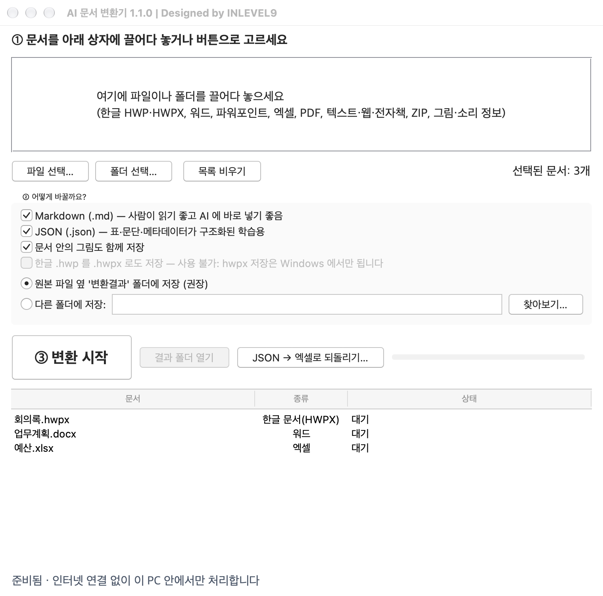
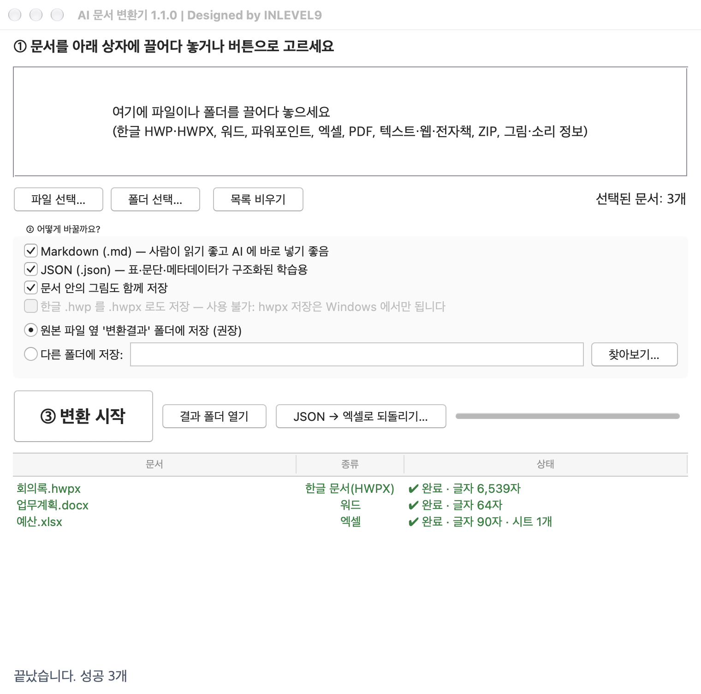

# AI 문서 변환기 | Designed by INLEVEL9

<br clear="all">

공공기관에 쌓여 있는 한글(hwp) 문서를 hwpx로 다시 저장하지 않아도, 폴더째 한꺼번에 AI가 읽기 좋은 **Markdown**과 **JSON**으로 바꿉니다. 워드, 파워포인트, 엑셀, PDF도 같은 방법으로 바꿉니다. 예를 들어 `회의록.hwp`를 변환하면 메모장으로 읽을 수 있는 `회의록.md`와 프로그램에서 처리하기 쉬운 `회의록.json`이 생깁니다. 한컴오피스 한글이 설치된 Windows PC라면 원본 `.hwp`를 `.hwpx`로 한꺼번에 다시 저장하는 것도 함께 할 수 있습니다.

반대 방향도 있습니다. 변환으로 만든 JSON은 버튼 한 번으로 엑셀로 되돌릴 수 있고, 사용하는 AI(ChatGPT, Claude 등)에 함께 제공하는 skill을 주면 "부서별 시트로 나눠서", "합계 넣어서"처럼 의도에 맞게 더 정확히 정리할 수 있습니다.

이 프로그램은 인터넷에 연결하지 않고 PC 안에서만 동작합니다. AI를 직접 부르지 않으며, 사용자가 쓰는 AI에 넘길 자료를 만드는 도구입니다.

Windows에서 `docforai.exe`를, Mac에서 `AI 문서 변환기.app`을 두 번 클릭하면 **AI 문서 변환기** 창이 열립니다. 이 창에서 문서를 고르고 변환한 뒤 결과 폴더를 열 수 있습니다. 배포 파일을 받아 두면 인터넷이 끊긴 PC에서도 변환할 수 있습니다.

## 1. 프로그램 열기

### Windows

1. [최신 버전 내려받기](https://github.com/inlevel9-com/doc-for-ai/releases/latest)를 열고 **Assets**에서 이름이 `-windows-x64.zip`으로 끝나는 파일을 내려받으세요.
2. 내려받은 ZIP 파일을 마우스 오른쪽 버튼으로 클릭하고 **모두 추출** 또는 **압축 풀기**를 선택하세요.
3. 압축을 푼 폴더에서 `docforai.exe`를 두 번 클릭하세요. Windows에서 파일 이름 끝을 숨기는 경우 `docforai`로 보일 수 있습니다. 압축을 푼 폴더 안의 파일은 함께 두세요.

폐쇄망 PC에서 사용하려면 인터넷이 되는 PC에서 ZIP을 받은 뒤 기관에서 허용하는 방법으로 옮기세요. 프로그램 설치나 계정 등록 없이 위와 같은 순서로 실행할 수 있습니다. [폐쇄망 사용 안내](docs/OFFLINE.md#windows-x64에서-실행)

### Mac

Apple Silicon(M1 이후) Mac용 파일을 함께 배포합니다. Intel Mac은 지원하지 않습니다.

1. [최신 버전 내려받기](https://github.com/inlevel9-com/doc-for-ai/releases/latest)의 **Assets**에서 이름이 `-macos-arm64.zip`으로 끝나는 파일을 내려받으세요. 내려받기 폴더에서 두 번 클릭하면 압축이 풀립니다.
2. 압축을 푼 폴더 안의 `AI 문서 변환기`를 두 번 클릭하세요.
3. 처음 열 때 "확인되지 않은 개발자" 또는 "열 수 없습니다" 안내가 나오면 **시스템 설정 → 개인정보 보호 및 보안**으로 가서 아래쪽의 **그래도 열기**를 누르세요. 이 프로그램은 Apple 개발자 서명을 받지 않았기 때문에 처음 한 번만 이 확인이 필요합니다. 이후에는 바로 열립니다.

## 2. 문서 변환하기

1. 프로그램에서 **파일 선택…** 버튼을 눌러 문서를 고르세요. 여러 문서를 한꺼번에 바꾸려면 **폴더 선택…** 버튼을 누르세요. 선택한 폴더 안의 하위 폴더도 함께 살펴봅니다.
2. 처음에는 체크 표시와 저장 위치를 그대로 두고 **③ 변환 시작**을 누르세요.
3. 변환이 끝나면 **결과 폴더 열기**를 누르세요. 기본 설정에서는 원본 문서가 있던 폴더 안에 `변환결과` 폴더가 생깁니다.

아래는 예시 문서 세 개를 선택하고 변환한 실제 앱 화면입니다. macOS에서 촬영했습니다.

**문서를 선택한 화면**



**변환이 끝난 화면**



## 3. 변환 결과 읽기

| 만들어지는 파일 | 어디에 쓰나요? |
| --- | --- |
| `.md` (Markdown) | 제목, 목록, 표가 들어 있는 글자 파일입니다. 메모장으로 열거나 필요한 부분을 복사할 수 있습니다. |
| `.json` (JSON) | 제목, 문단, 표 등을 구분해 기록한 파일입니다. 문서 내용을 다른 프로그램에 가져올 때 쓰입니다. |
| `문서이름_files` 폴더 | 문서에서 꺼낸 그림이 있을 때 생성됩니다. |

`.md` 파일을 여는 방법을 묻는 창이 뜨면 **메모장**을 선택하세요.

## 4. 한글 hwp를 hwpx로 한꺼번에 다시 저장하기

한컴오피스 한글(2018 이상 권장)이 설치된 Windows PC에서는 변환할 때 원본 `.hwp`를 `.hwpx`로도 저장할 수 있습니다. 프로그램이 한글을 보이지 않게 띄워 문서를 열고 hwpx로 저장하므로 서식이 그대로 유지됩니다.

1. **② 어떻게 바꿀까요?** 에서 **한글 .hwp 를 .hwpx 로도 저장**에 체크하세요. 한글이 없는 PC나 Mac에서는 이 항목이 회색으로 꺼져 있습니다.
2. 변환을 시작하면 `.md`, `.json`과 같은 결과 폴더에 `.hwpx`가 함께 생깁니다. 원본 `.hwp`는 바꾸지 않습니다.
3. 한글이 "파일 접근" 확인 창을 띄우면 허용을 누르세요. 문서가 많을 때 이 창을 없애는 방법은 [폐쇄망 사용 안내](docs/OFFLINE.md#한글-hwpx-저장)에 있습니다.

명령줄에서는 `--hwpx`를 붙입니다.

```bash
docforai 자료실\ --hwpx
```

## 5. JSON을 엑셀로 되돌리기

변환으로 만든 `.json`은 다시 엑셀 파일로 만들 수 있습니다. AI에 넘겼던 자료를 표로 정리해 보거나, 엑셀에서 뽑은 JSON을 다시 엑셀로 돌릴 때 씁니다. 버튼은 정해진 규칙대로 빠르게 만들고, 의도에 맞게 다듬는 일은 아래 6번처럼 AI에 맡기면 됩니다.

1. 프로그램에서 **JSON → 엑셀로 되돌리기…** 버튼을 누르고 `변환결과` 폴더의 `.json` 파일을 고르세요.
2. 같은 이름의 `.xlsx`가 JSON 파일 옆에 만들어집니다. **다른 폴더에 저장**을 골라 두었으면 그 폴더에 만들어집니다.

엑셀 안의 모습은 정해진 규칙을 따릅니다. 원본이 엑셀이나 표 형태 JSON이면 시트가 그대로 돌아오고, 그 밖의 문서는 `본문` 시트에 제목·문단이 한 줄씩, 표는 `표1`, `표2`… 시트에 들어갑니다. 자세한 규칙은 [JSON → Excel 매핑 규칙](docs/JSON_SCHEMA.md#json--excel-매핑-규칙)에 있습니다.

명령줄에서는 다음과 같이 씁니다.

```bash
docforai to-excel 변환결과/보고서.json -o 결과폴더
```

## 6. 사용하는 AI에 JSON 정리를 맡기기 (skill)

배포 파일의 `docs/skills/json-to-excel` 폴더가 AI용 skill입니다. 이 프로그램은 AI를 직접 부르지 않으므로, 평소 쓰는 AI에 이 skill과 `.json`을 주면 됩니다.

- **Claude**: `docs/skills/json-to-excel` 폴더를 통째로 skill로 등록하거나, 대화에 폴더를 ZIP으로 올리고 "이 skill대로 엑셀로 만들어 줘"라고 하세요. `SKILL.md`가 절차와 규칙을 담고 있습니다.
- **ChatGPT, Gemini 등**: `docs/skills/json-to-excel/CHATGPT.md`의 지침을 프로젝트 지침이나 맞춤 GPT에 붙여 넣고, 대화에 `.json`과 `scripts/json_to_excel.py`를 함께 올리세요.
- skill은 JSON 안의 내용만 다루며 인터넷에서 무엇을 찾아 채우지 않습니다. 폐쇄망 PC에서 쓰는 로컬 AI에도 같은 지침을 줄 수 있습니다.

## 지원하는 문서

| 문서 종류 | 파일 이름 끝 | 결과 |
| --- | --- | --- |
| 한글 문서 | `.hwp`, `.hwpx`, `.hwt`, `.hml` | 본문, 표, 그림 (`.hwp`는 한글이 있는 Windows에서 `.hwpx`로도 저장 가능) |
| 워드, 파워포인트, 엑셀 | `.docx`, `.pptx`, `.xlsx`, `.xls` | 본문, 표, 그림, 시트별 레코드(엑셀) |
| PDF | `.pdf` | 본문 글자 (스캔 PDF는 OCR 필요) |
| 텍스트, 웹, 전자책 | `.txt`, `.md`, `.csv`, `.html`, `.htm`, `.epub` | 본문, 표(CSV) |
| JSON | `.json` | 같은 모양의 객체 목록이면 표와 시트 레코드, 아니면 정리된 원문 |
| XML | `.xml` | RSS·Atom 피드는 글 목록으로, 그 밖에는 정리된 원문 |
| 압축 파일 | `.zip` | 안에 든 문서를 하나씩 변환해 한 결과로 묶음 (압축 안의 압축은 한 단계까지) |
| 그림 | `.jpg`, `.jpeg`, `.png`, `.gif`, `.bmp`, `.tif`, `.tiff`, `.webp` | 크기, 촬영 일시, 카메라, 위치 등 메타데이터만. 그림 속 글자(OCR)는 읽지 않음 |
| 소리 | `.mp3`, `.wav`, `.flac`, `.ogg`, `.opus`, `.m4a`, `.m4b`, `.aac`, `.wma`, `.aiff` | 제목·아티스트 태그, 길이 등 메타데이터만. 음성은 글자로 옮기지 않음 |
| 별도 변환 도구가 필요한 문서 | `.doc`, `.ppt`, `.rtf`, `.odt`, `.odp`, `.ods` | LibreOffice 필요 |

그림 속 글자 읽기(OCR)와 음성 인식은 넣지 않았습니다. 둘 다 수백 MB의 모델 파일을 따로 받아야 하고 한글 인식 품질을 보장하기 어려워, 인터넷 없이 ZIP 하나로 쓰는 이 프로그램의 범위 밖으로 두었습니다. 인터넷 주소(YouTube 등)도 폐쇄망 제품이라 다루지 않습니다.

## 결과가 비어 있거나 변환이 실패했을 때

- **빨간색으로 표시된 문서**를 두 번 클릭하면 실패 이유를 볼 수 있습니다.
- **스캔한 PDF**는 페이지가 사진으로만 저장되어 있을 수 있습니다. 이 경우 사진 속 글자를 읽어 검색할 수 있는 PDF로 만든 뒤 다시 변환하세요.
- **오래된 워드·파워포인트 파일**은 `.docx` 또는 `.pptx`로 다시 저장해 변환할 수 있습니다. 원래 형식 그대로 처리하려면 [구형 문서 변환 안내](docs/OFFLINE.md#구형-문서-변환-도구)를 참고하세요.

## 라이선스

Doc for AI는 [Apache License 2.0](LICENSE)에 따라 공개합니다. Windows 배포 파일에는 프로젝트의 라이선스와 함께 사용된 구성 요소의 라이선스 고지가 들어 있습니다.
